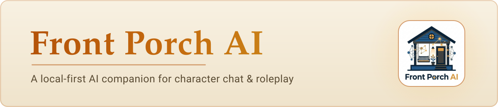
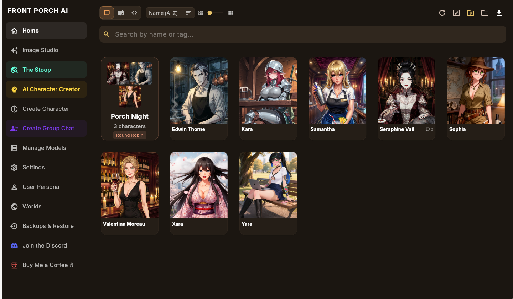
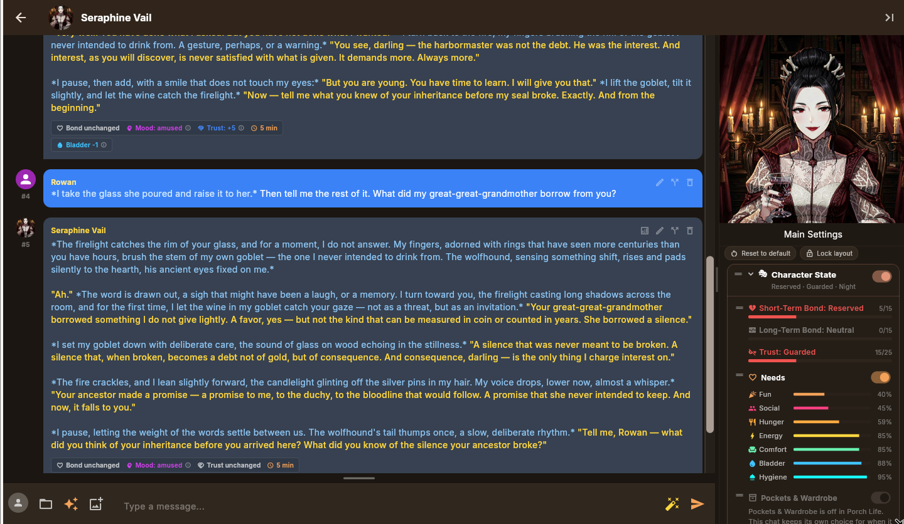
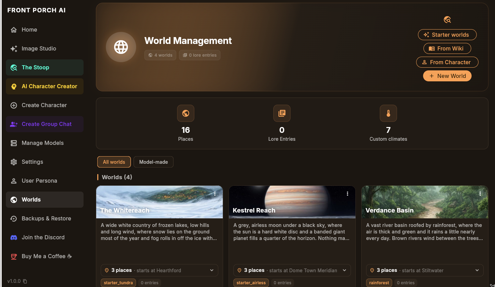
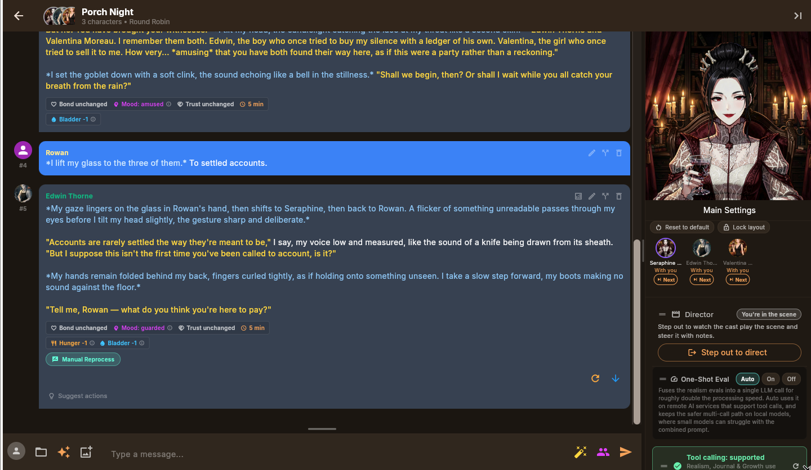
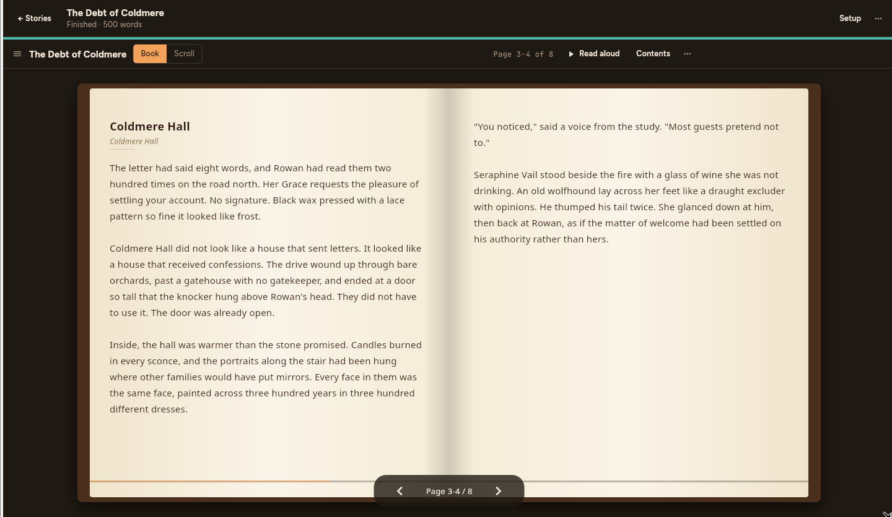
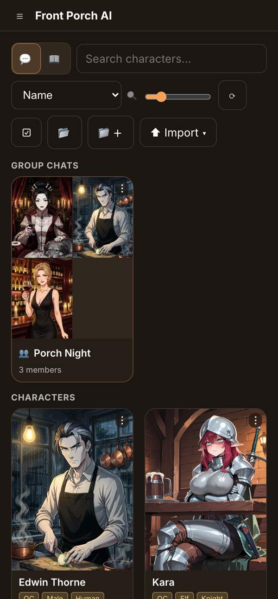
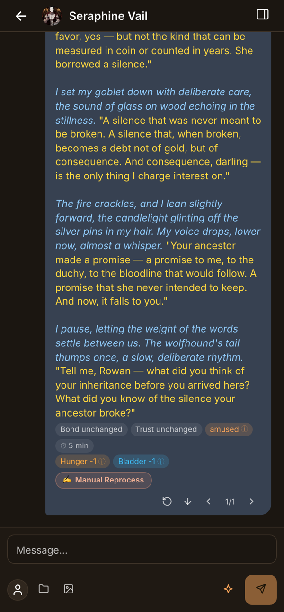
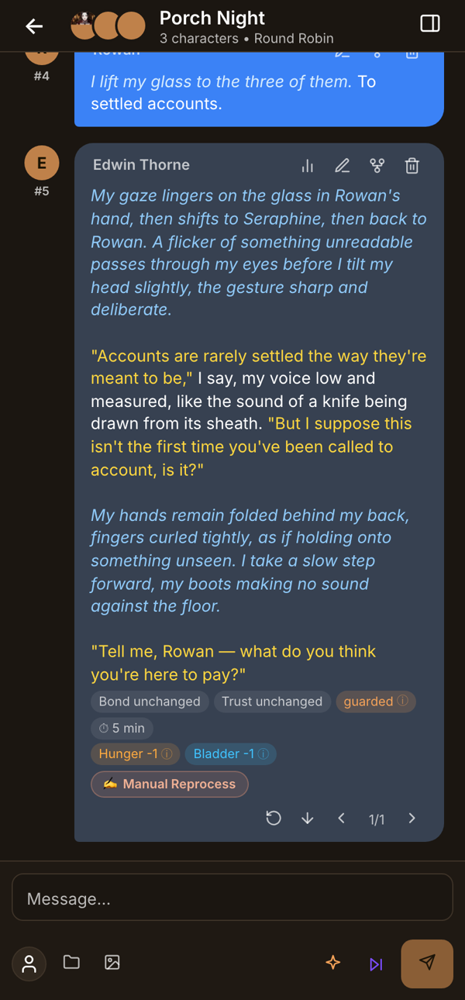
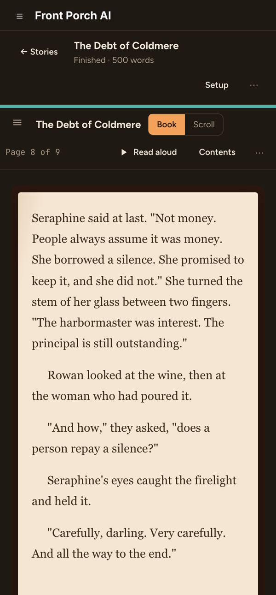

<picture>
  <source media="(prefers-color-scheme: dark)" srcset="docs/assets/porch-banner-dark.svg">
  
</picture>

<p align="center">
  <a href="https://github.com/linux4life1/front-porch-AI/actions/workflows/ci.yml"></a>
  
  
  
  
</p>

**Character chat where what you say leaves a mark.**

Front Porch AI is a free, open-source desktop app (Windows, macOS, Linux) for character chat and roleplay. It runs on your own machine, with KoboldCpp, oMLX or LM Studio, or a remote API if you prefer. The difference is **Porch Life**. With it switched on, every message you send moves something. Bond, trust and mood shift with how your words land; as the story's clock moves forward, needs like hunger and energy wear down; each chat keeps its own journal; and over a long story the character changes, with every step shown and undone if you regenerate.

It's all built in. Turn it on for one chat from the sidebar, or for every new chat in Settings → Porch Life.

**`main` is the stable release branch.** All work targets `Rawhide` and is promoted here when it's ready. Nightlies are built from Rawhide and keep a **separate** library, so they never touch a stable install.

> ### 💍 New in 1.7.1 — Porch of the Rings
> One editor to edit them all: a group and every member in it now open the character editor you know, and each character in a group keeps their own switches, memory and name.
>
> - **Edit group is a page, and a member is a character.** The same tabs as a character, with the group's own fields, and members edited in the character editor.
> - **A group chat's sidebar reads like a 1:1,** with Group Dynamics showing how each character feels about the others.
> - **Each character keeps their own.** Realism, Needs, Afterglow and memory belong to each character in a group.
> - **Characters keep their title.** A full name or the card's premise beside the name; Backyard AI and Stoop titles come along.
> - **The web app catches up.** Its character editor, home toolbar, menus and navigation now match the desktop's.
>
> The in-app What's New has all six.

**Docs:** [User guide](https://frontporchai.app) · [Getting started](docs/getting-started.md) · [Install](docs/install.md) · [FAQ](docs/faq.md) · [Discord](https://discord.gg/e4tET6rpdv)

<p align="center">
  
</p>

---

## What makes it different


With Porch Life on, before each reply the app reads what *you* just said and scores how it lands: bond, trust, mood, and a feeling that lingers. A **story clock** moves forward as the scene does (judged by the model each turn), and seven needs (hunger, bladder, energy, social, fun, hygiene, comfort) wear down as story hours pass and feed into how they feel and what they want next.

Mood matters. A character with a grievance may argue, withdraw or refuse, and a goal they care about can make or ruin their day. Promises are tracked as kept, broken or still hanging. Every change shows under the message that caused it ("Bond +1", "picked up: sungold tomato"), and regenerating or deleting a message rewinds it exactly.

[Porch Life](docs/porch-life.md) · [Realism Engine](docs/realism-engine.md)

<p align="center">
  
</p>


Each chat keeps its own **Journal**: diary cards and a running "where we are", updated as the story goes. **Growth Rings** record how a character changes over a long story, with receipts, so a regenerate or delete can undo the change. With the clock and Journal on, **Dreams** arrive after a story night. Long-term recall (RAG) runs locally and remembers who said each line. None of it leaks into another chat with the same character.


**Living Worlds** give a story somewhere to happen. A place has lore, seasons and a climate, and the weather follows the story's date: rain, snow, fog, lightning, and a sun and moon that cross the sky with the story clock behind the chat. Seven starter worlds ship in the box. **World from Wiki** builds a world, with its places and lore, from a fandom wiki.

<p align="center"></p>


Put several characters in one scene, or grow a 1:1 into a group with `/join`. Each member keeps their own feelings, needs, pockets and lore, exactly as they would one-on-one. Bring someone in as a **Scene Guest** for a moment, or step out with **Director mode** and steer the scene with `/whisper`, `/narrate` and `/goal`.

<p align="center"></p>


**Porch Stories** distills a chat, or just an idea, into a novel: concept, cast, outline, beats, prose, and a rewrite pass. Read it in a page-flip book with optional read-along narration, or export an EPUB or an audiobook voiced by your TTS voices.

<p align="center"></p>


The app downloads KoboldCpp, picks the right build for your GPU (NVIDIA, AMD ROCm, Vulkan, Metal, or a build for older CPUs), and estimates whether the model and context you picked will fit before it loads. Voices (Kokoro, Piper, Whisper push-to-talk) run inside the app, with no Python. A second, smaller model can take the background work (feelings, journal) so your chat model stays fast.


The desktop app serves its own phone and browser app over your home network or Tailscale. Chats, the library, Porch Life, settings, Image Studio, worlds, Porch Stories, backups and The Stoop are all there, with the same controls in the same order. The desktop stays on; it is the brain.

<table><tr><td width="25%"></td><td width="25%"></td><td width="25%"></td><td width="25%"></td></tr></table>

[Web & phone](docs/web-phone.md)


An opt-in, 18+, account-based hub for sharing characters, whole **group casts** (members, portraits, lorebooks, starting feelings) and **worlds**. Browse in the app or at [hub.frontporchai.app](https://hub.frontporchai.app). The rest of the app never needs an account.

---


[Backyard AI has shut down](https://backyard.ai/). If you saved your characters as `.byaf` archives, **Import Backyard AI (.byaf)** brings them across with their pictures and your personas, converted to standard cards. SillyTavern, Chub and Risu V2 cards (PNG or JSON) import too, and Front Porch's own `.porch` format moves a whole library between machines.

A local app can't be switched off on you. Your library lives in a folder you control, and the **AGPL-3.0-or-later** license (since v0.9.0) means any hosted fork has to stay open.

---

## Everything else

- **Chat:** streamed replies; regenerate, swipe, continue, impersonate, edit, fork; photo attach (vision models, or a local captioner for text-only ones); slash commands and `@` mentions; private reasoning in a collapsible **Thought** chip; find in chat; SillyTavern import and export.
- **Characters:** Quick Create and a guided AI creator; **AI Enhance** grows a card from its chats; an avatar gallery with several looks per character; expression packs that follow mood; likes, dislikes, ambitions, a work schedule and a birthday.
- **Lorebooks:** a real activation engine (keys, scan depth, sticky and cooldown, token budget); imports SillyTavern, NovelAI, Agnai and RisuAI books.
- **Pictures:** Image Studio drives A1111, Forge, SD.Next, ComfyUI or Draw Things on your machine, or Nano-GPT, OpenRouter and xAI remotely. `/image` paints the scene into the chat.
- **Voice:** Kokoro (50+ voices), Piper (import your own voices), ElevenLabs or OpenAI; Whisper push-to-talk; voice calls on desktop.
- **Backends:** KoboldCpp, oMLX (Apple Silicon), LM Studio, OpenRouter, Nano-GPT, xAI, or any OpenAI-compatible URL. Intel Macs can't run local models, so pick a remote backend; the app won't switch you silently.
- **Looks:** eight themes, light and dark, with your own accent colour and fonts.
- **Backups:** local snapshots every 30 minutes plus seven daily copies, one-click restore, and an optional full backup that includes settings. No cloud sync.
- **Waifu Coder:** a managed [OpenCode](https://github.com/anomalyco/opencode) coding session on localhost, using its own pinned build.

### How it compares

| | **Front Porch AI** | SillyTavern | Jan | Backyard AI |
|---|---|---|---|---|
| Made for | Character chat and roleplay | Character chat and roleplay | General AI assistant | ✗ Shut down |
| App | Native desktop (Flutter) | Local web UI | Desktop (Tauri) | ✗ |
| Local models | Manages KoboldCpp for you; oMLX, LM Studio | Connects to many backends | Built-in llama.cpp | ✗ |
| Remote APIs | OpenRouter, Nano-GPT, xAI, any OpenAI-compatible | Very wide | OpenAI, Anthropic, Mistral, Groq and more | ✗ |
| Character simulation (needs, clock, mood, growth) | Built in | ✗ | ✗ | ✗ |
| Voice in and out | Built in, local | Built-in extensions | ✗ | ✗ |
| Image generation | Built in | Built-in extension | ✗ | ✗ |
| Phone | Served by the desktop app | Browse to the ST UI | ✗ | ✗ |
| License | AGPL-3.0-or-later | AGPL-3.0 | Apache-2.0 | ✗ |

---

## Install

**Stable** (this branch): [Releases](https://github.com/linux4life1/front-porch-AI/releases) — Windows `.exe`, notarized macOS `.pkg`, Linux AppImage / `.deb` / `.rpm` / `.tar.gz`.

**Nightly** (from `Rawhide`): pre-release builds on the same Releases page, for Windows, macOS, AppImage and `.tar.gz`.

Full platform notes (FUSE, the AUR, building from source): **[Installation guide](docs/install.md)**.

### Linux packages (stable)

**Debian / Ubuntu / Mint / Pop!_OS**
```bash
curl -fsSL https://apt.frontporchai.app/install.sh | bash
sudo apt install front-porch-ai
```

**Fedora / RHEL**
```bash
sudo dnf config-manager --add-repo https://rpm.frontporchai.app/front-porch-ai.repo
sudo dnf install front-porch-ai
```

**Arch (AUR)** — `yay -S front-porch-ai-bin` (stable) or `yay -S front-porch-ai-beta-bin` (nightly).

### First launch

1. **Backend** — let the app fetch KoboldCpp, or point it at oMLX / LM Studio / OpenRouter / a custom URL.
2. **Model** — Manage Models → Search / Download pulls from HuggingFace. `Q4_K_M` / `Q5_K_M` is a sensible start.
3. Hardware settings are chosen for you. GPU layers and the rest live in the chat's Model Settings if you want to tune them.

Voices, memory embeddings, the expression reader and the photo captioner download the first time you turn those features on. Apart from those, the app only checks GitHub for app and KoboldCpp updates (you can turn the update check off).

---

## Docs

| | |
|---|---|
| [Getting started](docs/getting-started.md) | First launch to first chat |
| [User guide](docs/user-guide.md) | The reference |
| [Chatting](docs/chatting.md) · [Porch Life](docs/porch-life.md) · [Characters](docs/characters.md) | How a conversation, a life, and a card actually work |
| [Image Studio](docs/image-studio.md) · [Web & phone](docs/web-phone.md) | Pictures, and the PWA |
| [FAQ](docs/faq.md) · [Troubleshooting](docs/troubleshooting.md) | When it will not talk |
| [What's New (stable)](docs/main.md) · [Rawhide nightlies](docs/Rawhide.md) · [Release notes](docs/release-notes.md) | What changed |
| [CONTRIBUTING.md](CONTRIBUTING.md) | How to send a patch |

---

## Contributing

All work targets **`Rawhide`**.

```bash
git clone https://github.com/linux4life1/front-porch-AI.git
cd front-porch-AI
git checkout Rawhide
flutter pub get
flutter run
```

Read [CONTRIBUTING.md](CONTRIBUTING.md) before opening a pull request. Linux extra packages for a source build are in the [install guide](docs/install.md#for-developers-building-from-source).

---

## Privacy

Offline use collects nothing. The **only** account is **The Stoop**, and only if you sign in (signed in, it sends an anonymous analytics ping you can turn off in Account). Chats, cards, and models stay in a folder you control (`FrontPorchAI` in Documents; `FrontPorchAI-Beta` for nightlies). Remote APIs you configure receive *your* prompts — not a Front Porch server.

[Privacy Policy](PRIVACY.md)

---

## Credits

| Project | Role |
|---|---|
| [KoboldCpp](https://github.com/LostRuins/koboldcpp) | Local GGUF backend |
| [sherpa-onnx](https://github.com/k2-fsa/sherpa-onnx) | In-process Whisper + local voices |
| [Kokoro](https://github.com/hexgrad/kokoro) | Default local TTS |
| [Piper](https://github.com/OHF-Voice/piper1-gpl) | Lightweight local TTS |
| [OpenCode](https://github.com/anomalyco/opencode) | Waifu Coder's managed coding loop |
| [Flutter](https://flutter.dev) | The desktop (and the PWA's host) |

If Front Porch is useful, a star on those projects helps the people who actually made the engines.

**Character Card Forge** ([@FrozenKangaroo](https://github.com/FrozenKangaroo/Character-Card-Forge)) is a community editor that can seed Realism state.

---

## License

**v0.9.0 and later** — [AGPL-3.0-or-later](LICENSE)
**v0.8.x and earlier** — GPL-3.0

---

*Built with 🧡 using [Flutter](https://flutter.dev)*
